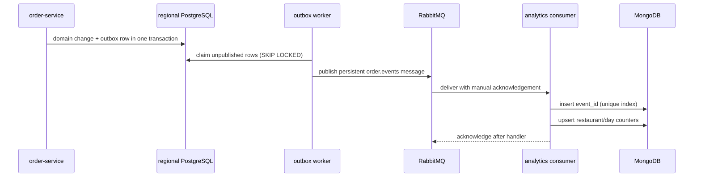

# Analytics service — system design

Analytics builds a small read model from order-service events. It never calls
order-service on dashboard reads and does not sit on the checkout path.

## Event pipeline

The queue binds `order.#` and `payment.#`, but v1 registers only `order.placed`. Other
matching event types are acknowledged and ignored until a handler exists.

## Read model and access

For each `order.placed`, the handler converts `placedAt` to a UTC day and atomically
increments one MongoDB document keyed by `(restaurantId, date)`. It stores order count and
`subtotal` in integer minor units; delivery and service fees are excluded. Additive counters
make each update a small upsert instead of a scan over operational orders.

The read API is `GET /api/analytics/restaurants/{restaurantId}/days`. It verifies the
core-issued JWT, enforces restaurant ownership and the `analytics:read` permission, and
reads MongoDB. Permissions are fetched from core on cache miss; system admins bypass the
restaurant permission check.

## Delivery semantics and trade-offs

- RabbitMQ uses a durable topic exchange/queue and manual acknowledgements. Malformed or
  failed messages go to a dead-letter queue; unknown event types are acknowledged.
- A unique MongoDB index on `event_id` suppresses duplicate deliveries; a seven-day TTL
  bounds dedupe storage. Keeping this guard in Mongo avoids adding Redis just for dedupe.
- This is **not strict exactly-once processing**: the consumer records `event_id` before
  the aggregate upsert, and those are separate writes. A crash or handler failure between
  them can lose an aggregate update; replaying a DLQ message requires removing its dedupe
  record first. Replays after the TTL can double-apply an event that was already counted.
  A Mongo transaction or an atomic inbox/projection design would close that gap, at added
  operational cost.

The aggregate collection has a unique `(restaurantId, date)` index for upserts and a date
index for range reads. Analytics can therefore scale consumers and dashboard reads
independently from the order database.
